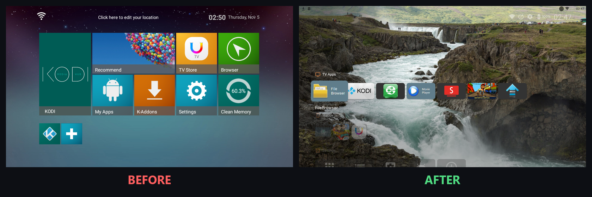
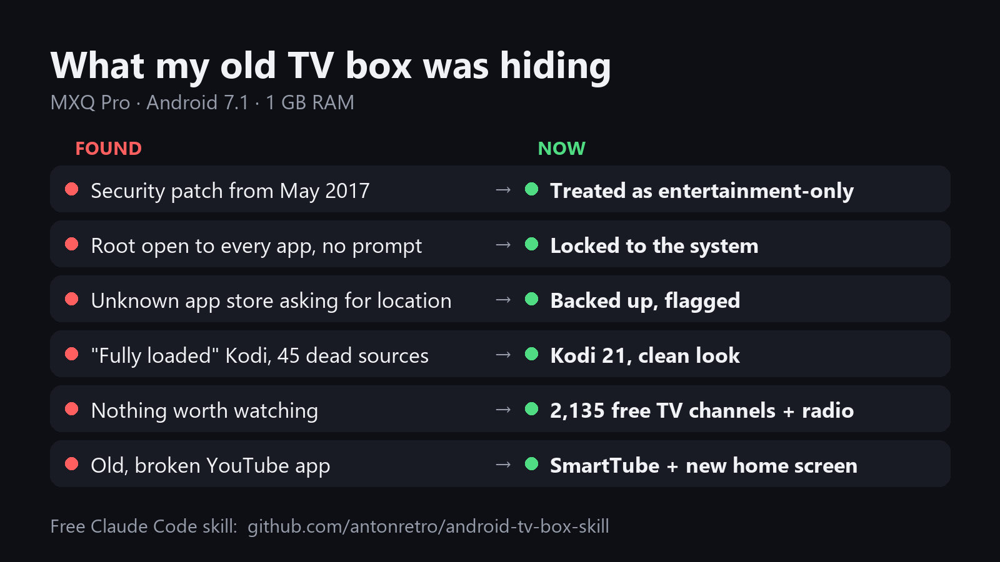
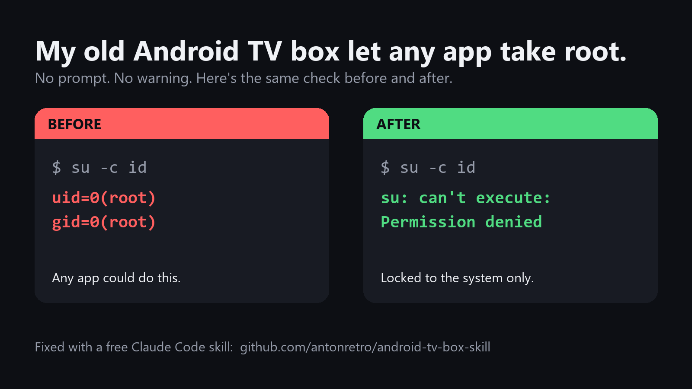

# Android TV Box Makeover: a Claude Code skill

**Plug in a cheap Android TV box, ask Claude, and it turns the box into a clean, safe, great entertainment box.**







Works with the usual cheap boxes (MXQ Pro, X96, T95, H96 and other Amlogic, Rockchip or Allwinner boxes). Everything is done over your home network with ADB, from your PC. Claude walks you through each step and tells you what will appear on the TV.

## What it does

1. **Audits the box**: real specs, Android version, every installed app and what it's allowed to do, hidden root access, Kodi add-ons. Cheap boxes often ship "fully loaded" with sketchy apps and **root access any app can grab with no prompt**.
2. **Backs everything up** to your PC first, scans the apps with your antivirus, and runs an **adware check** that looks inside every app for ad networks, trackers and risky permissions.
3. **Cleans and secures** it: removes dead or flagged apps (only the ones you agree to) and locks down open root.
4. **Upgrades Kodi** to the latest official version with Kodi's clean default look.
5. **Free live TV, radio and weather**: builds a channel list for the countries you pick, from [iptv-org](https://github.com/iptv-org/iptv) (TV) and [Radio Browser](https://www.radio-browser.info) (radio), small enough to stay smooth on a 1 GB box.
6. **Apps**: SmartTube for YouTube, Projectivy Launcher for a modern home screen (your old menu stays), RetroArch for retro games, plus free legit apps like Pluto TV and Tubi.
7. **Speed tweaks** that actually help on weak hardware.
8. Leaves a notes file, so you or another assistant can pick up later.

## Install

1. Install [Claude Code](https://claude.com/claude-code).
2. Copy the `skills/android-tv-box` folder into your skills folder:
   - Windows: `%USERPROFILE%\.claude\skills\`
   - Mac/Linux: `~/.claude/skills/`
3. Have [Android SDK Platform Tools](https://developer.android.com/tools/releases/platform-tools) (ADB) and Python 3 on your PC.

## Use

1. Plug the box into your TV and network.
2. In Claude Code, say: **"Set up my Android TV box"** (or "make my TV box the best it can be").
3. Follow along. Claude will ask you to turn on USB debugging (7 clicks on Build, then a switch) and to press OK on the TV once.

## Free channel list on its own

`skills/android-tv-box/build_channels.py` works without Claude too:

```
python build_channels.py channels.m3u CA,US,GB,AU
```

It writes one playlist with TV channels for those countries (geo-blocked and part-time channels removed), a Weather group, and popular radio stations marked for Kodi's Radio section. Load it in Kodi's **PVR IPTV Simple Client**.

## Notes

- Tested on an MXQ Pro (Amlogic S905W, 1 GB RAM, Android 7.1.2, 32-bit) in November 2026.
- Old boxes don't get security updates. Treat them as entertainment-only: no personal logins.
- Some iptv-org entries are unofficial rebroadcasts; the skill won't pick or test those for you.

## License

MIT. Not affiliated with Kodi, iptv-org, Radio Browser, SmartTube, Projectivy or any box maker.
